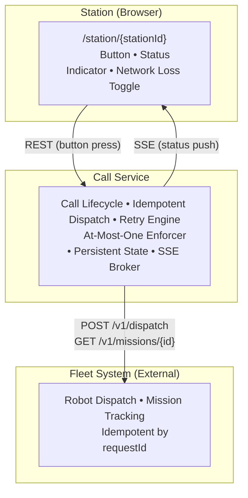
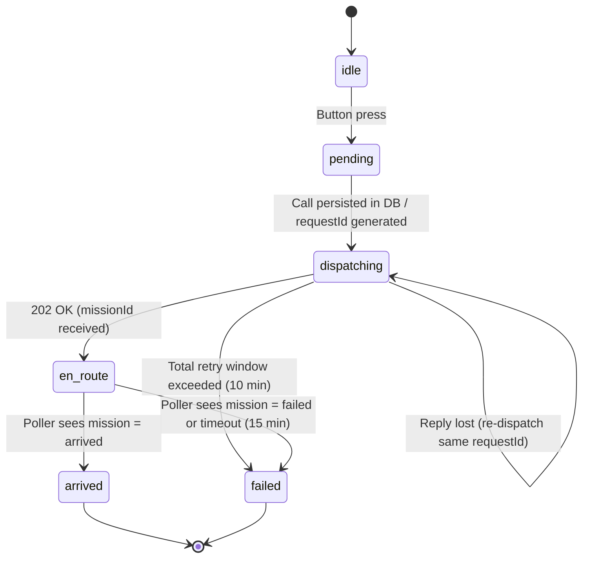

# Call Station — Design Document
**Virya Autonomous Technologies · Systems Solutions Engineer**
*v1.0 · November 2026*

---

## D1 — Architecture

### Overview

The system has three distinct layers, each with a narrow, well-defined responsibility.



### Component Responsibilities

| Component | Knows | Does NOT Know |
|-----------|-------|---------------|
| **Station (Browser)** | Its own `stationId` (from URL path), current call state (received via SSE / GET) | Robot identity, mission details, other stations |
| **Call Service** | All stations and their call states, `requestId` per call, `missionId` after dispatch, retry state, full call history | Fleet internals, robot routing logic |
| **Fleet** | Robots, missions, dispatch routing | Stations, call service state, `stationId` |

---

## D2 — Call Lifecycle

### State Diagram



### State Transitions

| Transition | Trigger | Retried? | Timeout? |
|------------|---------|----------|----------|
| `idle → pending` | Button press received | No | No |
| `pending → dispatching` | Call persisted, dispatch attempted | — | — |
| `dispatching → en_route` | Fleet returns 202 | N/A | 10 min total |
| `dispatching → dispatching` | 409 busy → wait `retryAfterSeconds` | Yes | — |
| `dispatching → dispatching` | Unavailable / timeout → exponential backoff | Yes | — |
| `dispatching → dispatching` | Reply lost → re-dispatch same `requestId` | Yes | — |
| `en_route → arrived` | Mission poller sees `arrived` | N/A | 15 min |
| `en_route → failed` | Mission poller sees `failed` or timeout | No | 15 min |
| `dispatching → failed` | Total retry window exceeded | No | 10 min |

### Retry Policy
- **Fleet busy (409):** Wait exactly `retryAfterSeconds` from response body, then retry.
- **Fleet unavailable / timeout:** Exponential backoff starting at 2 s, doubling each attempt, capped at 60 s, with ±20 % random jitter to prevent thundering herd.
- **Reply lost:** Retry immediately using the same `requestId`. The fleet's idempotency guarantee ensures no duplicate mission is created.
- **Mission tracking:** A single background poller queries all active missions every 5 s. On service restart it resumes from DB state — no in-memory state is required.

---

## D3 — Failure Decisions

| Failure | Detection | Behaviour | Rationale |
|---------|-----------|-----------|-----------|
| **Duplicate press** | Open call already exists for `stationId` in DB | Return current call state; no new call created | DB partial unique index + service-layer check; UX shows "call already active" |
| **Station connection lost mid-press** | SSE stream drops; POST may be in-flight | On reconnect, page GETs `/api/call/{stationId}` and renders true server state | Station holds zero local state; server is the single source of truth |
| **Reply lost after dispatch** | HTTP call to fleet times out with no response | Re-dispatch with the same `requestId`; fleet returns the original mission (idempotency guarantee) | `requestId` is generated and persisted *before* the first dispatch attempt |
| **Fleet unavailable** | HTTP errors / connection refused on dispatch | Exponential backoff + jitter; call stays in `dispatching`; all retry state persisted in DB | Poller and dispatcher are both restart-safe; no silent data loss |
| **Fleet always busy** | 409 responses on every dispatch attempt | Wait `retryAfterSeconds`, retry; UI shows "Waiting for available robot" | Respects fleet's own backoff signal; operator stays informed |
| **Call service restarts mid-call** | — | On boot, service loads all non-terminal calls from DB and resumes polling / retrying | Zero in-memory state required for correctness; DB is the durable source of truth |

---

## D4 — Interfaces and Identity

### Transport Choice: SSE + REST

Station-to-service communication uses **HTTP REST** for commands (button press) and **Server-Sent Events (SSE)** for status updates.

**Why SSE + REST over WebSocket:**
- Status flow is strictly unidirectional (server → client); full-duplex is not needed.
- SSE is a native browser API requiring no special framing or upgrade handshake.
- REST for button press is stateless, simple to reason about, and straightforward to retry on the client.
- Both work transparently over HTTP/2 multiplexing and standard reverse proxies.

**Why not long-polling or plain polling:**
- Long-polling holds a connection slot per station; SSE is equivalent but cleaner.
- Plain polling (every N seconds) adds unnecessary latency and load.

### Example Messages

**Button press (Station → Call Service):**
```
POST /api/call/A3
Authorization: Bearer tok-a3-xxxx
Content-Type: application/json
Body: {}

Response 202:
{ "callId": "c8f1e2a0-...", "status": "pending", "destination": "A3" }

Response 409 (open call exists):
{ "callId": "c8f1e2a0-...", "status": "en_route", "message": "call already active" }
```

**SSE status stream (Call Service → Station):**
```
GET /api/events/A3
Authorization: Bearer tok-a3-xxxx

data: {"callId":"c8f1e2a0-...","status":"dispatching","updatedAt":"2026-11-06T10:00:01Z"}

data: {"callId":"c8f1e2a0-...","status":"en_route","robotId":"R4","updatedAt":"2026-11-06T10:00:12Z"}

data: {"callId":"c8f1e2a0-...","status":"arrived","robotId":"R4","updatedAt":"2026-11-06T10:01:05Z"}
```

**Dispatch (Call Service → Fleet):**
```
POST /v1/dispatch
Content-Type: application/json
{ "requestId": "c8f1e2a0-...", "destination": "A3" }

Response 202:
{ "missionId": "m-789", "robotId": "R4" }

Response 409:
{ "retryAfterSeconds": 20 }
```

**Mission poll (Call Service → Fleet):**
```
GET /v1/missions/m-789
Response 200:
{ "missionId": "m-789", "status": "en_route" }
```

### Station Identity and Authentication

**Production design (mTLS):**
Each station is provisioned with a unique X.509 client certificate. The certificate's Common Name (CN) encodes the `stationId`. The Call Service validates the client certificate against a known CA on every request. The CN is treated as the authenticated `stationId` — no other identity token is needed.

Advantages:
- Credential never travels in the clear; private key never leaves the station.
- Revocation per station without changing shared secrets.
- Hardware stations can store the private key in a secure element (e.g., ATECC608).

**Prototype (pre-shared token):**
Each station has a Bearer token defined in `stations.yaml`. The station page includes the token in the `Authorization` header. This delta from the design is documented in the README.

---

## D5 — Data Model

### Storage Choice: Relational Database

A relational database with ACID guarantees is used. It provides partial unique indexes (the primary mechanism for at-most-one enforcement), transactional updates, and persistent state that survives service restarts.

### Schema

**`calls` table** — primary state machine:
```sql
CREATE TABLE calls (
    id           UUID        PRIMARY KEY DEFAULT gen_random_uuid(),
    station_id   TEXT        NOT NULL,
    destination  TEXT        NOT NULL,
    request_id   UUID        NOT NULL UNIQUE,
    mission_id   TEXT,
    robot_id     TEXT,
    status       TEXT        NOT NULL
                             CHECK (status IN (
                               'pending','dispatching','en_route','arrived','failed'
                             )),
    retry_count  INT         NOT NULL DEFAULT 0,
    retry_after  TIMESTAMPTZ,
    created_at   TIMESTAMPTZ NOT NULL DEFAULT now(),
    updated_at   TIMESTAMPTZ NOT NULL DEFAULT now()
);

-- Enforces at-most-one open call per station at database level
CREATE UNIQUE INDEX one_open_call_per_station
    ON calls (station_id)
    WHERE status NOT IN ('arrived', 'failed');
```

**`call_events` table** — immutable audit log:
```sql
CREATE TABLE call_events (
    id       BIGSERIAL   PRIMARY KEY,
    call_id  UUID        NOT NULL REFERENCES calls(id),
    status   TEXT        NOT NULL,
    note     TEXT,
    ts       TIMESTAMPTZ NOT NULL DEFAULT now()
);
```

### At-Most-One Open Call Per Station

Enforced at two layers ("belt and suspenders"):

1. **Service layer:** Before inserting a new call, the service queries for any existing call with a non-terminal status for that `stationId`. If found, it returns the existing call.
2. **Database layer:** A partial unique index on `(station_id) WHERE status NOT IN ('arrived', 'failed')` causes the database to reject any INSERT that violates the constraint, even under concurrent requests that bypass the service-layer check.

### Request ID Stability

`requestId` is generated as a UUID v4 at call creation and written to the `calls` row before the first dispatch attempt. It never changes. This means every retry to the fleet — whether due to a timeout, lost reply, or service restart — uses the identical `requestId`, guaranteeing the fleet's idempotency property is exercised correctly.

---

## D6 — Scale and Operation (40 Stations, 10 Robots)

### What Changes

| Area | Change Needed |
|------|---------------|
| **Nothing breaks immediately** | The design handles 40 stations without modification |
| **Mission poller** | At 40 open calls, the single poller makes ~40 HTTP requests every 5 s (8 rps). Still manageable; first candidate for optimisation. |
| **SSE broker** | In-process broker works for a single instance. If the Call Service is horizontally scaled, SSE connections must be sticky (consistent hashing on `stationId`) or moved to a pub/sub layer (e.g., Redis Pub/Sub). |
| **Robot contention** | 40 stations competing for 10 robots produces more 409 responses. A per-station priority queue or station-level scheduling may be needed. |

### What Breaks First

The SSE broker. Horizontal scaling without sticky sessions causes SSE clients on Instance A to miss events published on Instance B. Solution: move event fan-out to a shared pub/sub channel.

### What to Monitor

| Metric | Threshold |
|--------|-----------|
| `calls_open` per station | Alert if > 1 |
| `dispatch_retry_count` per call | Alert if > 10 |
| `fleet_latency_p99` | Alert if > 5 s |
| `mission_poll_lag` | Alert if poller falls behind by > 15 s |
| `sse_connected_clients` | Capacity planning |
| Fleet health endpoint | Alert on failure |

---

## D7 — Real Hardware (Microcontroller Button)

| Concern | Decision |
|---------|----------|
| **Input handling** | Hardware RC debounce filter + software 10 ms ignore window. Event fires on falling edge only; long-press is ignored. |
| **Offline behaviour** | The `requestId` for a pending call is written to non-volatile flash *before* the first transmission attempt. On reconnect, the station re-sends the same `requestId`. The Call Service is idempotent; no duplicate call is created. |
| **Power loss** | Same as offline: `requestId` in flash survives power cycle. On boot, the firmware checks for a pending `requestId` and retransmits if the response was not received. |
| **Credentials** | Private key stored in a hardware secure element (e.g., ATECC608A). The key is generated on-device and never exported. mTLS handshake proves identity without transmitting secrets. |
| **Updates** | Firmware delivered over HTTPS with a cryptographically signed image. Bootloader verifies signature before swapping partitions. Automatic rollback on three consecutive boot failures. Updates staged to a subset of stations before full rollout. |

The station communicates with the Call Service over HTTPS + SSE, the same protocol as the browser prototype. No protocol changes are required; only the TLS client certificate replaces the Bearer token.

---

## D8 — Trade-offs

### Trade-off 1: SSE + REST vs. WebSocket

**Chosen: SSE + REST**

| Dimension | SSE + REST | WebSocket |
|-----------|-----------|-----------|
| Complexity | Low — two independent HTTP primitives | Higher — upgrade handshake, framing, ping/pong |
| Fit for use case | Excellent — updates are unidirectional | Over-engineered for one-way push |
| Proxy / firewall compatibility | Excellent — standard HTTP | Variable — some proxies block WS upgrades |
| Hardware client | Standard TLS stack | Requires WS library on microcontroller |

**What would reverse it:** If stations need to send frequent bidirectional data (e.g., continuous sensor readings, sub-second heartbeats) then the persistent bidirectional channel of WebSocket becomes the right choice.

---

### Trade-off 2: Relational DB (single source of truth) vs. In-memory + write-ahead log

**Chosen: Relational database with ACID guarantees**

| Dimension | Relational DB | In-memory + WAL / event log |
|-----------|--------------|----------------------------|
| Correctness | Strong — ACID transactions, partial indexes | Requires careful replay logic to reach correct state |
| Operational simplicity | Moderate — managed service available | Low — WAL compaction, snapshot management |
| At-most-one enforcement | Native partial unique index | Must be re-derived on replay |
| Restart recovery | Automatic — query DB on boot | Must replay log; risk of divergence |

**What would reverse it:** If call volume were extremely high (thousands of stations, sub-millisecond latency required) then an event-sourced architecture with an in-memory projection would outperform a relational store. At the scale described (≤40 stations, ~1 call per station per hour), the relational database is the simpler and safer choice.
