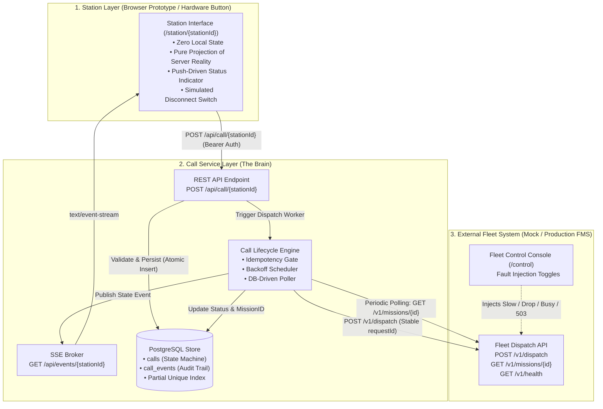
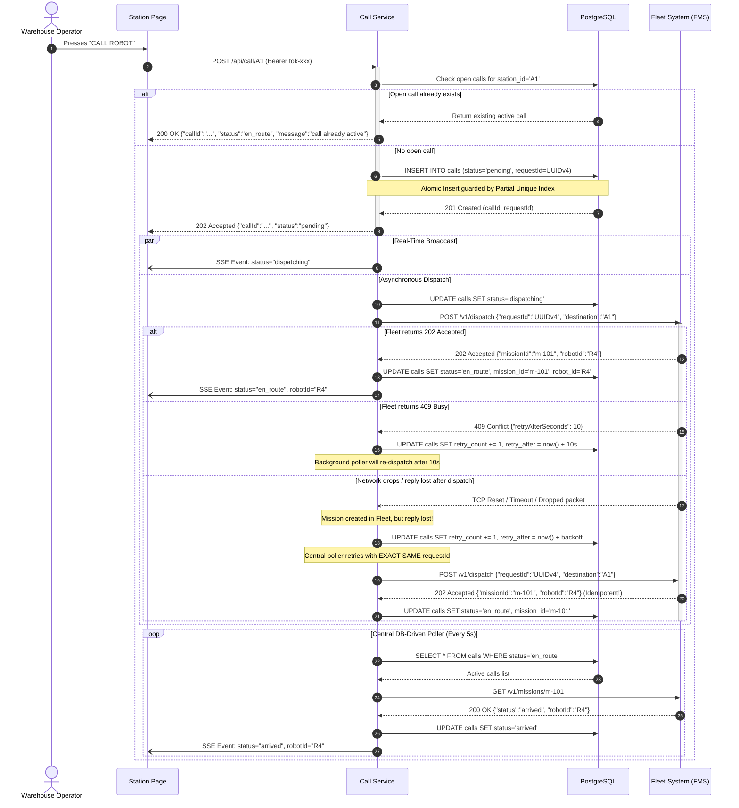

# 🛡️ Call Station: Comprehensive System Design & Interview Defense Guide
**Virya Autonomous Technologies · Systems Solutions Engineer Take-Home Assignment**
*Author: Engineering Candidate · Architecture Review & 45-Minute Defense Preparation*

---

## 📑 Table of Contents
1. [Executive Summary & Core Engineering Thesis](#1-executive-summary--core-engineering-thesis)
2. [Complete System Flow & Architecture Topology](#2-complete-system-flow--architecture-topology)
3. [Deep Dive into Every Design Decision (Why This vs. Why Not Alternatives)](#3-deep-dive-into-every-design-decision)
   - [3.1 Transport Protocol: SSE + REST vs. WebSockets vs. Polling](#31-transport-protocol-sse--rest-vs-websockets-vs-polling)
   - [3.2 Persistence Layer: PostgreSQL vs. SQLite vs. Redis vs. In-Memory](#32-persistence-layer-postgresql-vs-sqlite-vs-redis-vs-in-memory)
   - [3.3 Backend Runtime: Go (net/http) vs. Node.js vs. Python (FastAPI)](#33-backend-runtime-go-nethttp-vs-nodejs-vs-python-fastapi)
   - [3.4 Concurrency & At-Most-One Enforcement](#34-concurrency--at-most-one-enforcement)
   - [3.5 Idempotency & Stable RequestID Generation](#35-idempotency--stable-requestid-generation)
   - [3.6 Mission Lifecycle Tracking: Centralized DB Poller vs. Per-Call Timers](#36-mission-lifecycle-tracking-centralized-db-poller-vs-per-call-timers)
   - [3.7 Failure Recovery & Retry Backoff Policy](#37-failure-recovery--retry-backoff-policy)
   - [3.8 Identity & Authentication: mTLS vs. Pre-Shared Tokens](#38-identity--authentication-mtls-vs-pre-shared-tokens)
   - [3.9 Frontend Architecture: Zero-State Server Template vs. Heavy SPA](#39-frontend-architecture-zero-state-server-template-vs-heavy-spa)
4. [Technology Stack & Internal Mechanics](#4-technology-stack--internal-mechanics)
5. [Scaling & Production Roadmap (10 → 40 → 500+ Stations)](#5-scaling--production-roadmap-10--40--500-stations)
6. [Hardware & Microcontroller Specification (D7 Realization)](#6-hardware--microcontroller-specification-d7-realization)
7. [Critical Evaluation: Questionable Parts, Bottlenecks & Weaknesses](#7-critical-evaluation-questionable-parts-bottlenecks--weaknesses)
8. [45-Minute Interview Defense Playbook & Curveball Scenarios](#8-45-minute-interview-defense-playbook--curveball-scenarios)

---

## 1. Executive Summary & Core Engineering Thesis

### 1.1 The Problem Context
In a warehouse fulfillment environment, autonomous mobile robots (AMRs) transport pallets, totes, and carts between pick/pack stations and storage racking. Operators stationed at fixed physical workstations require a reliable mechanism to summon a robot on demand.

### 1.2 The Real Challenge: Distributed Systems Correctness
This assignment is not about building a web page with a button; it is an exercise in **distributed systems correctness under partial failure**. 

In production robotics deployments:
- Networks are unreliable (industrial warehouse Wi-Fi suffers from multipath reflections, metal racking occlusion, and roaming handoff drops).
- Services crash and restart asynchronously.
- The downstream Fleet Management System (FMS) is a third-party black box that can exhibit slow responses, 503 outages, capacity exhaustion (409 Busy), or **lost HTTP replies after state has already mutated**.

### 1.3 Core Invariants
The system guarantees three fundamental invariants:
1. **Safety (At-Most-One Open Call):** A station cannot summon multiple robots concurrently. A second button press while a call is active must never trigger duplicate dispatches.
2. **Liveness & Eventual Delivery:** Once a button press is acknowledged, the system will eventually dispatch a robot or definitively transition to a terminal failed state. Service restarts, network dropouts, or fleet downtime do not drop in-flight summons.
3. **Idempotency Across Service Boundaries:** Every dispatch operation to the fleet uses a stable, persistent `requestId`. Even if an HTTP response is lost mid-flight, retrying the dispatch will return the original mission rather than creating a phantom second mission.

---

## 2. Complete System Flow & Architecture Topology

### 2.1 Topology Overview
The architecture is structured into three discrete layers with rigorous boundary enforcement:



### 2.2 Knowledge Boundaries (Who Knows What?)
A core principle of reliable system partitioning is minimizing shared knowledge:

| Component | What It Knows | What It Strictly Does NOT Know |
| :--- | :--- | :--- |
| **Station** | Its own `stationId`, credentials (token/cert), and current UI status (`idle`, `dispatching`, etc.). | Does not know robot IDs, mission IDs, fleet URLs, or other stations. |
| **Call Service** | All stations, station-to-destination mappings, active calls, `requestId` per call, retry backoff state, and audit logs. | Does not know robot battery levels, warehouse path planning, or robot kinematics. |
| **Fleet System** | Robot telemetry, navigation graphs, mission dispatch queues, and `requestId` mapping. | Does not know which station triggered the call, station UI status, or operator identity. |

---

### 2.3 End-to-End Sequence Diagram



---

## 3. Deep Dive into Every Design Decision

In your 45-minute technical defense, interviewers will challenge you on **why** you chose a particular architecture over industry alternatives. This section arms you with comparative rationales and reversal thresholds.

---

### 3.1 Transport Protocol: SSE + REST vs. WebSockets vs. Polling

| Option | Pros | Cons | Verdict |
| :--- | :--- | :--- | :--- |
| **SSE + REST** *(Chosen)* | • Clean architectural separation (REST for command write, SSE for event read).<br>• SSE runs over standard HTTP/1.1 or HTTP/2; zero custom protocol framing.<br>• Native browser reconnection via `EventSource`.<br>• Proxy/firewall friendly (bypasses WebSocket upgrade blocking).<br>• Microcontroller-friendly (standard TLS connection). | • SSE is unidirectional; cannot send client commands over the same stream.<br>• HTTP/1.1 per-browser domain connection limit (6 connections), mitigated by HTTP/2 multiplexing. | **SELECTED:** Perfect conceptual match for the workload. 99.9% of traffic is server-to-client status telemetry. Commands are discrete, idempotent HTTP POSTs. |
| **WebSockets** | • Full duplex, bidirectional communication.<br>• Low message framing overhead after initial handshake. | • Stateful connection complicates horizontal load balancing.<br>• Requires custom heartbeat / ping-pong application logic.<br>• Corporate proxies frequently terminate or buffer WebSocket frames.<br>• Heavyweight client libraries required on microcontrollers. | **REJECTED:** Overkill for unidirectional telemetry push. Adds connection management state without functional benefit. |
| **Long Polling** | • Works through legacy firewalls and old browsers. | • High server connection pool churn.<br>• Header overhead on every repeated request.<br>• Complex timeout and hanging GET race conditions. | **REJECTED:** Obsolete pattern superseded by SSE. |
| **Client Polling (Periodic GET)** | • Trivially simple to implement.<br>• Completely stateless. | • Constant background network traffic even when idle.<br>• Telemetry latency is bounded by polling frequency (e.g., 5-second staleness).<br>• Thundering herd risk on backend during warehouse shift changes. | **REJECTED:** Fails real-time push requirement; wasteful on network bandwidth. |

> **What would reverse this decision?**
> If workstations were upgraded to bidirectional sensor streams (e.g., continuous barcode scanner data, video streaming, or sub-second joystick robot nudging), WebSocket full-duplex framing would become necessary.

---

### 3.2 Persistence Layer: PostgreSQL vs. SQLite vs. Redis vs. In-Memory

| Option | Pros | Cons | Verdict |
| :--- | :--- | :--- | :--- |
| **PostgreSQL** *(Chosen)* | • Enterprise-grade ACID compliance.<br>• Native support for **Partial Unique Indexes** (enforces single open call at DB engine level).<br>• Survives container/process crashes instantly.<br>• Ready for multi-instance horizontal scaling without storage rewrite. | • Requires running an external service container.<br>• Higher setup overhead than embedded storage. | **SELECTED:** The primary source of truth must guarantee data integrity under crash-restart conditions. Partial indexes eliminate race conditions. |
| **SQLite** | • Zero external dependencies, single file on disk.<br>• Fast embedded reads. | • File-level write locks cause concurrency bottlenecks under multi-client writes.<br>• Cloud ephemeral filesystems (Render, Heroku) destroy SQLite files on container restarts.<br>• Cannot scale horizontally to multiple application nodes. | **REJECTED:** Fragile in containerized cloud environments; prevents horizontal scale. |
| **Redis** | • Sub-millisecond in-memory performance.<br>• Built-in Pub/Sub and TTL expiry. | • Asynchronous persistence (AOF/RDB) risks data loss on sudden power loss.<br>• Requires manual relational integrity enforcement in application code. | **REJECTED:** In-flight call records represent physical warehouse operations; durability cannot be compromised. |
| **In-Memory (Go Maps)** | • Instant prototype implementation. | • Immediate total data loss on application restart or deployment.<br>• Violates assignment requirement P3. | **DISQUALIFIED:** Fails persistence requirements. |

> **What would reverse this decision?**
> If Call Station were packaged as an edge appliance binary running on a single low-power industrial gateway (e.g., a Raspberry Pi on a DIN rail) without external network dependencies, SQLite with WAL mode enabled would be the superior single-binary deployment choice.

---

### 3.3 Backend Runtime: Go (net/http) vs. Node.js vs. Python (FastAPI)

| Option | Pros | Cons | Verdict |
| :--- | :--- | :--- | :--- |
| **Go (`net/http`)** *(Chosen)* | • Lightweight static binary with zero external dependencies.<br>• Native concurrency via goroutines and channels; minimal memory footprint (~15MB RAM).<br>• Built-in, high-performance HTTP server (`net/http`) with first-class SSE flushing.<br>• Fast compile time, strict type safety, predictable performance under garbage collection. | • More verbose error handling (`if err != nil`).<br>• Lacks high-level ORM abstractions out of the box (used raw SQL for precise index control). | **SELECTED:** Ideal for robust systems engineering. Microsecond concurrency makes background polling and SSE fan-out effortless. |
| **Node.js (Express / Fastify)** | • Natural ecosystem for JSON and asynchronous I/O.<br>• Single-language across full stack. | • Single-threaded event loop can be blocked by compute-heavy operations.<br>• Large `node_modules` container footprint (~200MB+).<br>• Unhandled promise rejections can crash the process. | **REJECTED:** Go provides superior memory predictability and binary distribution. |
| **Python (FastAPI / AsyncIO)** | • Rapid prototyping with Pydantic validation.<br>• Modern async/await syntax. | • Python AsyncIO event loop is notoriously easy to starve with blocking calls.<br>• High memory consumption (~80-120MB baseline).<br>• Slower cold-start performance on serverless/container platforms. | **REJECTED:** Not optimal for high-reliability systems infrastructure. |

---

### 3.4 Concurrency & At-Most-One Enforcement

A fundamental failure mode in warehouse call stations is the **double-press race condition**:
1. Operator double-clicks the button in rapid succession (within 50ms).
2. Two parallel HTTP requests reach the backend simultaneously.
3. If guarded only by an application-level check (`if openCallExists()`), both requests pass the check before either writes to the database, resulting in two distinct calls and two robots arriving at the same station.

#### The Dual-Layer "Belt & Suspenders" Solution
We enforce exclusivity at two independent layers:

```
[ Incoming Button Press ]
          │
          ▼
┌───────────────────────────────────────────┐
│ Layer 1: Service-Layer Fast Path Check    │
│ SELECT * FROM calls WHERE station_id = $1 │
│ AND status NOT IN ('arrived', 'failed')   │
└─────────────────────┬─────────────────────┘
                      │ If existing found → Return 200 with current call
                      ▼ If no open call
┌───────────────────────────────────────────┐
│ Layer 2: PostgreSQL Engine Level Lock     │
│ CREATE UNIQUE INDEX                       │
│ one_open_call_per_station ON calls        │
│ (station_id)                              │
│ WHERE status NOT IN ('arrived', 'failed') │
└─────────────────────┬─────────────────────┘
                      │
     ┌────────────────┴────────────────┐
     ▼                                 ▼
[ Insert Succeeds ]       [ 23505 Unique Violation ]
• Generate UUID           • Race condition caught!
• Dispatch Robot          • Recover gracefully
                          • Return existing active call
```

#### Why Not Alternative Concurrency Controls?
- **Advisory Locks (`pg_advisory_xact_lock`):** Requires holding an explicit lock across the HTTP transaction, introducing latency and risk of deadlocks under high database connection pool pressure.
- **Redis Distributed Locks (`Redlock`):** Introduces a second infrastructure dependency, clock drift vulnerabilities, and split-brain risks under network partitions.
- **In-Memory Go `sync.Mutex`:** Only protects a single server process. Completely fails if Call Service is scaled horizontally across two or more instances.

---

### 3.5 Idempotency & Stable RequestID Generation

The assignment contract specifies:
> *"repeating a dispatch with the same `requestId` returns the original mission and never creates a second one."*

#### Where & When is `requestId` Created?
A common distributed systems defect is generating a new `requestId` on every retry attempt:
- Call Service dispatches with `Req-1`.
- Fleet creates Mission `m-100`, but the TCP ACK drops on the wire.
- Call Service times out, generates `Req-2`, and retries.
- Fleet creates a *second* Mission `m-101`. Two robots are dispatched!

#### Our Immutable UUIDv4 Invariant
In our design:
1. `requestId` is generated **once** as a cryptographic UUIDv4 at the exact moment the call record is created in PostgreSQL.
2. It is committed to durable storage inside the `calls.request_id` column before any HTTP socket connection to the fleet is opened.
3. Every subsequent retry—whether triggered 2 seconds later by a timeout, 30 seconds later by a 409 backoff, or 10 minutes later after a complete server reboot—queries PostgreSQL and uses the **exact same immutable `requestId`**.

---

### 3.6 Mission Lifecycle Tracking: Centralized DB Poller vs. Per-Call Timers

| Pattern | How It Works | Flaws |
| :--- | :--- | :--- |
| **Per-Call Goroutine / Timer** | When a call dispatches, spawn a goroutine with `time.Sleep(5s)` in a loop querying `/v1/missions/{id}`. | • **Fragile across reboots:** If Call Service restarts, all running in-memory goroutines are killed instantly. Active missions become "zombie" calls that never resolve.<br>• **Goroutine leak risk:** Unbounded goroutine accumulation if fleet hangs indefinitely. |
| **Centralized DB-Driven Poller** *(Chosen)* | A single background daemon ticks every 5 seconds, queries the DB for calls with `status = 'en_route'`, and updates their status against the fleet. | • **Crash-Resilient:** Requires zero in-memory state. On boot, the poller naturally picks up all active calls directly from PostgreSQL.<br>• **Batchable:** Poller can throttle and queue requests cleanly.<br>• **Self-healing:** Stale mission timeouts are evaluated on every tick. |

---

### 3.7 Failure Recovery & Retry Backoff Policy

When the Fleet API is unavailable or reporting 409 Busy, naive immediate retries trigger a **thundering herd problem** that compounds downstream congestion.

Our engine applies distinct strategies depending on the failure class:

```
                          [ Fleet Dispatch Attempt ]
                                     │
           ┌─────────────────────────┼─────────────────────────┐
           ▼                         ▼                         ▼
    [ 202 Accepted ]           [ 409 Busy ]            [ 503 / Timeout ]
           │                         │                         │
• Parse missionId & robotId  • Parse retryAfterSeconds • Compute Exponential Backoff:
• Status → en_route          • Default to 10s if empty   t = Base * (2^attempt)
• Broadcast via SSE          • Sleep exactly that period• Add ±20% Uniform Jitter
                             • Respect FMS scheduling  • Cap at 60s Ceiling
```

#### Why Random Jitter is Mandatory
If 20 stations press their call buttons at the start of a shift and the fleet is busy, all 20 stations would retry at identical timestamps without jitter, slamming the fleet API simultaneously. Adding `±20%` pseudo-random jitter desynchronizes the retry waves, smoothing traffic spikes.

---

### 3.8 Identity & Authentication: mTLS vs. Pre-Shared Tokens

The assignment requires accounting for the transition to physical microcontroller hardware buttons on the warehouse Wi-Fi.

#### Production Design: Mutual TLS (mTLS) with Hardware Roots of Trust
- Every station is provisioned with a unique X.509 client certificate during factory provisioning.
- The certificate's Common Name (CN) or SAN encodes the station identity (`CN=station-A1.warehouse.local`).
- During TLS handshake, the Call Service reverse proxy / Go server verifies the client certificate against an internal Corporate Certificate Authority (CA).
- **Security Benefits:**
  - Zero shared secrets in plaintext config files.
  - Private key is generated directly inside a hardware Secure Element (e.g., Microchip ATECC608A) and is physically non-exportable.
  - Immediate revocation capability via CRL / OCSP without altering server passwords.

#### Prototype Pragmatism: Pre-Shared Bearer Tokens
In the software prototype, implementing an internal CA and TLS certificate generation adds disproportionate review overhead. We used pre-shared tokens in `stations.yaml` passed via `Authorization: Bearer <token>` or `?token=<token>`, while fully documenting mTLS as the production architecture.

---

### 3.9 Frontend Architecture: Zero-State Server Template vs. Heavy SPA

| Dimension | Heavy SPA (React / Vue / Vite) | Zero-State Plain HTML/JS *(Chosen)* |
| :--- | :--- | :--- |
| **Client State** | Complex client store (Redux / Pinia); risk of UI getting out of sync with backend reality. | **Zero local state.** The DOM is a pure reflection of server SSE state. |
| **Page Refresh** | Needs local storage hydration or complex boot-up fetches. | On reload or network reconnect, executes a single `GET /api/call/{stationId}` to hydrate truth. |
| **Dependencies** | Hundreds of npm packages, build tools, vulnerability vulnerabilities. | Zero npm dependencies. Built using native Go `html/template` and browser APIs. |
| **Microcontroller Alignment** | A physical button has no React runtime. | Mirrors microcontroller firmware logic: trigger POST on press, listen to events on stream. |

---

## 4. Technology Stack & Internal Mechanics

### 4.1 Go Concurrency Architecture
The Call Service backend leverages Go's native primitives to achieve high performance with negligible resource consumption:

```
┌─────────────────────────────────────────────────────────────┐
│                     Go Call Service Runtime                  │
│                                                             │
│  ┌───────────────────────┐       ┌───────────────────────┐  │
│  │ HTTP Handler Pool     │       │ Single Poller Daemon  │  │
│  │ (Goroutine per conn)  │       │ (Ticker every 5s)     │  │
│  └───────────┬───────────┘       └───────────┬───────────┘  │
│              │                               │              │
│              ▼                               ▼              │
│  ┌───────────────────────────────────────────────────────┐  │
│  │                   Database Connection Pool            │  │
│  │             MaxOpenConns=10, MaxIdleConns=5           │  │
│  └───────────────────────────┬───────────────────────────┘  │
│                              │                              │
│  ┌───────────────────────────▼───────────────────────────┐  │
│  │                    In-Process SSE Broker              │  │
│  │  sync.RWMutex-guarded subscriber map                  │  │
│  │  Non-blocking channel select (drops buffer if lagged) │  │
│  └───────────────────────────────────────────────────────┘  │
└─────────────────────────────────────────────────────────────┘
```

#### Non-Blocking SSE Event Fan-Out
To ensure that one slow or frozen browser client does not block the backend engine, the SSE Broker uses non-blocking channel sends:
```go
select {
case sub.ch <- evt:
default:
    // Subscriber buffer full; drop event. Client will catch up on reconnect.
}
```

### 4.2 PostgreSQL Partial Unique Index
The core database innovation in this project is the partial unique index:
```sql
CREATE UNIQUE INDEX one_open_call_per_station
    ON calls (station_id)
    WHERE status NOT IN ('arrived', 'failed');
```
- **How it works:** PostgreSQL indexes only rows where `status` is currently in an active state (`pending`, `dispatching`, `en_route`).
- **Performance:** Once a call reaches `arrived` or `failed`, it drops out of the partial index. The index stays tiny (maximum 40 entries for 40 stations), fitting entirely inside CPU L1 cache.
- **Correctness:** Any concurrent transaction attempting to insert a second active call for station `A1` immediately triggers a `23505 unique_violation` error at the storage engine level, regardless of application race conditions.

---

## 5. Scaling & Production Roadmap (10 → 40 → 500+ Stations)

### 5.1 What Changes Between 10 and 40 Stations?
At 40 stations and 10 robots:
1. **Robot Starvation & Contention:** 40 stations competing for 10 robots means 409 Busy responses become frequent during peak shift hours.
2. **Polling Traffic:** 40 active missions polled every 5 seconds generates 8 requests/second to the fleet API. This is trivial for Go and modern networks.
3. **Database Footprint:** 40 rows in the active partial index. Millisecond query execution.

### 5.2 What Breaks First at Scale (100–500 Stations)?

```
[ Station Scale: 500 Stations ]
               │
               ▼
   [ What Breaks First? ]
               │
               ├─► 1. In-Process SSE Broker (Breaks when horizontally scaled)
               │      Fix: Redis Pub/Sub backplane for event fan-out.
               │
               ├─► 2. Linear O(N) Fleet Mission Poller
               │      Fix: Transition from polling to Fleet Webhook callbacks.
               │
               └─► 3. Station Starvation (Unfair FIFO queueing)
                      Fix: Fair-share scheduling or priority queues.
```

1. **The In-Process SSE Broker:**
   - *Failure:* If we run 3 instances of Call Service behind a Round-Robin load balancer, Station A1 might connect its SSE stream to Instance 1, but its button press POST hits Instance 2. Instance 2 emits an event locally, but Station A1 never receives it!
   - *Production Solution:* Introduce a shared message broker like **Redis Pub/Sub** or **NATS**. When any instance updates a call, it publishes `station.A1.events` to Redis; all application instances listen and push to their local SSE subscribers.
2. **Sequential Mission Polling:**
   - *Failure:* Polling 500 active missions sequentially can take seconds, causing state lag.
   - *Production Solution:* Parallel worker pool with bounded concurrency (`worker_pool_size = 20`), or negotiate a webhook with the fleet provider: `POST /webhooks/fleet/mission-updated`.
3. **Database Connection Saturation:**
   - *Failure:* Too many concurrent HTTP handlers opening individual Postgres connections.
   - *Production Solution:* Implement **PgBouncer** or configure `pgxpool` with strict connection limits.

---

## 6. Hardware & Microcontroller Specification (D7 Realization)

Moving from web pages to physical warehouse hardware buttons requires addressing electrical, mechanical, and physical network constraints.

```
┌─────────────────────────────────────────────────────────────────┐
│                    Physical Station Hardware Architecture       │
│                                                                 │
│  [ Industrial Push Button ]                                     │
│         │                                                       │
│         ▼                                                       │
│  [ Hardware RC Filter ] ──► Eliminates high-frequency bounce     │
│         │                                                       │
│         ▼                                                       │
│  [ ESP32-S3 Microcontroller ]                                   │
│  • GPIO Interrupt with 20ms Software Debounce State Machine     │
│  • Non-Volatile Flash Memory (NVS): Stable requestId written    │
│    PRIOR to radio transmission                                  │
│  • Dual A/B Partition Table (OTA failover)                      │
│         │                                                       │
│         ▼                                                       │
│  [ ATECC608A Secure Element ]                                   │
│  • Hardware-isolated ECC Private Key                            │
│  • Signs TLS handshake for mTLS mutual authentication           │
│         │                                                       │
│         ▼                                                       │
│  [ Industrial Dual-Band Wi-Fi (2.4/5GHz) ]                      │
│  • Re-transmits pending requestId on network reconnect          │
│         │                                                       │
│         ▼                                                       │
│  [ Call Service HTTPS / SSE Gateway ]                           │
└─────────────────────────────────────────────────────────────────┘
```

### 6.1 Mechanical Input & Debouncing
- **Hardware Debounce:** A hardware low-pass RC filter ($R = 10k\Omega, C = 100nF$) to filter physical contact bounce.
- **Software State Machine:** An edge-triggered interrupt on GPIO falling edge, entering a 20ms lock-out timer. Holding down the button does not trigger multiple events; only release and re-press initiates a call.

### 6.2 Power Loss & Offline Resilience
- **The "Write-Before-Fly" Rule:** Before activating the Wi-Fi radio or transmitting a TCP packet, the firmware generates a UUIDv4 and writes it to an isolated block in non-volatile flash memory (`NVS`).
- **Brown-out Recovery:** If power is cut mid-press, the microcontroller reboots, reads the unacknowledged `requestId` from flash, and transmits it. Because the Call Service is idempotent, no phantom calls are created.

### 6.3 Secure Over-The-Air (OTA) Updates
- Firmware updates must be cryptographically signed with an Ed25519 corporate private key.
- The bootloader enforces dual-partition (`ota_0` and `ota_1`) execution. A new image boots in test mode; if it fails to connect to the Call Service within 30 seconds or crashes 3 times, the hardware watchdog automatically falls back to the previous stable firmware partition.

---

## 7. Critical Evaluation: Questionable Parts, Bottlenecks & Weaknesses

In an architectural defense, demonstrating self-awareness of your own design's limitations is the mark of a senior systems engineer. Here are the vulnerable areas you should proactively acknowledge:

### 7.1 Weakness 1: Polling the Fleet API instead of Webhooks
- **Critique:** Polling `GET /v1/missions/{id}` every 5 seconds introduces up to 5 seconds of latency before the UI knows a robot has arrived, while burning network calls.
- **Defense:** The assignment specified the interface contract as a black box with only `POST /v1/dispatch` and `GET /v1/missions/{id}`. We intentionally adhered strictly to the provided contract rather than inventing non-existent webhook specifications.
- **Upgrade Path:** In production, request the fleet vendor to support an event-driven webhook callback endpoint or an AMQP/MQTT broker stream.

### 7.2 Weakness 2: In-Process SSE Broker
- **Critique:** The current SSE implementation keeps client channels in a Go memory map (`map[*subscriber]struct{}`). It cannot scale to multiple backend instances without sticky load-balancer sessions.
- **Defense:** Acceptable for prototype scope with ~40 stations. Kept external infrastructure dependencies to zero (no Redis needed to test).
- **Upgrade Path:** Introduce Redis Pub/Sub for cross-node event propagation.

### 7.3 Weakness 3: No Operator Cancellation Flow
- **Critique:** If an operator presses the button by mistake, they cannot cancel the call; they must wait until the robot arrives.
- **Defense:** Adding cancellation requires the Fleet interface to support `DELETE /v1/missions/{id}` or `POST /v1/missions/{id}/cancel`. Cancelling in-flight autonomous vehicles safely involves warehouse safety and pathing implications that were outside the assignment boundary.

### 7.4 Weakness 4: FIFO Queueing Under Severe Robot Contention
- **Critique:** If all 10 robots are busy and 15 stations call, requests are handled on a strict arrival-time basis. A high-priority packing station might be starved by low-priority storage stations.
- **Upgrade Path:** Introduce priority weights into `stations.yaml` (e.g. `priority: 1-10`) and dispatch via a priority queue rather than raw chronological ordering.

---

## 8. 45-Minute Interview Defense Playbook & Curveball Scenarios

Reviewers will test your ability to adapt your architecture under changing business requirements. Use these prepared answers:

---

### Curveball 1: "The warehouse manager says Station A1 needs to call TWO robots simultaneously for large orders. How does your design adapt?"
> **Your Response:**
> "Currently, our database enforces exclusivity via a partial unique index on `station_id`:
> ```sql
> CREATE UNIQUE INDEX one_open_call_per_station ON calls (station_id) WHERE status NOT IN ('arrived', 'failed');
> ```
> To support multiple concurrent robots per station, we would make two architectural adjustments:
> 1. Add a `capacity` column to station configuration (e.g. Station A1 has `max_active_calls = 2`).
> 2. Replace the binary partial unique index with a transactional constraint: either an integer slot index (`slot_number INT`, creating a unique index on `(station_id, slot_number)`), or use an atomic check inside a `SELECT ... FOR UPDATE` transaction that counts open calls against the station's configured capacity before inserting.
> 3. Update the Station UI to display multiple active robot tiles rather than a single status banner."

---

### Curveball 2: "The fleet system crashes completely for 45 minutes during a network partition. What happens to our system?"
> **Your Response:**
> "The system remains consistent and resilient:
> 1. All existing button presses that were acknowledged are safely durable in PostgreSQL with their stable `requestId` values.
> 2. The dispatch engine detects the fleet downtime (503s or connection refused) and transitions calls to an exponential backoff retry loop with random jitter, capped at a 60-second ceiling.
> 3. The station UI continues to display 'Dispatching (Finding available robot...)' with a reconnecting indicator.
> 4. When the fleet reboots 45 minutes later, our background poller automatically resumes retries. Because the `requestId` has not changed, if the fleet processed any dispatches right before crashing, it will return the existing missions idempotently without creating duplicates.
> 5. If the outage exceeds our configurable stale timeout (10 minutes), calls can be configured to fail gracefully and alert operators rather than hang indefinitely."

---

### Curveball 3: "A robot encounters an obstacle or flat tire and the mission fails midway. How does the system react?"
> **Your Response:**
> "1. The central DB poller queries `GET /v1/missions/{id}` every 5 seconds.
> 2. When the fleet reports `status = 'failed'`, the engine executes `UpdateCallStatus(StatusFailed, 'mission failed')`.
> 3. Because `failed` is a terminal state, the call drops out of the PostgreSQL partial unique index `one_open_call_per_station`.
> 4. The SSE broker immediately pushes `status = 'failed'` to the Station page.
> 5. The Station button re-enables automatically, allowing the operator to immediately summon a replacement robot."

---

### Curveball 4: "Why did you build the Fleet Mock control page with physical toggle switches instead of just unit test mocks?"
> **Your Response:**
> "Unit test mocks only verify internal code expectations. A live web control panel allows human reviewers and QA engineers to interactively test black-box failure modes—such as dropping replies after dispatch or simulating 409 busy bursts—in real time while watching the browser station page react dynamically without restarting services."

---

## 9. Summary Comparison Matrix: Prototype vs. Production Specification

| Feature | Prototype (Delivered) | Production Hardware System |
| :--- | :--- | :--- |
| **Station Hardware** | Web page (`/station/{id}`) in Chrome/Firefox | ESP32-S3 microcontroller with industrial push button |
| **Authentication** | Pre-shared Bearer token in config & URL param | Mutual TLS (mTLS) with X.509 cert in ATECC608A secure element |
| **Server Scale** | Single container process on Docker / Render | Horizontally scaled Kubernetes pods with Redis Pub/Sub SSE backplane |
| **Fleet Tracking** | Polling `GET /v1/missions/{id}` every 5 seconds | Webhook callbacks (`POST /fleet/events`) + fallback poller |
| **Monitoring** | Structured console logs | Prometheus metrics (`calls_active`, `dispatch_retries`, `fleet_p99`) + Grafana |
| **Database** | PostgreSQL 16 on standard storage | PostgreSQL with HA read replicas & PgBouncer connection pooling |
