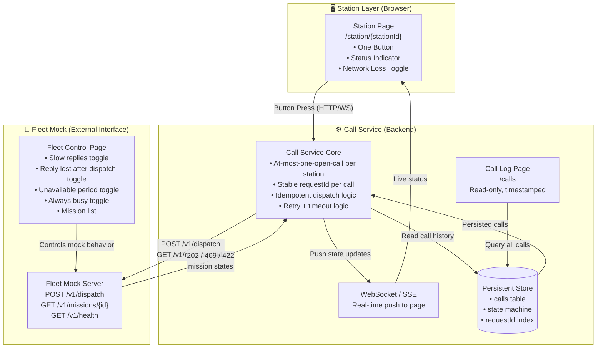
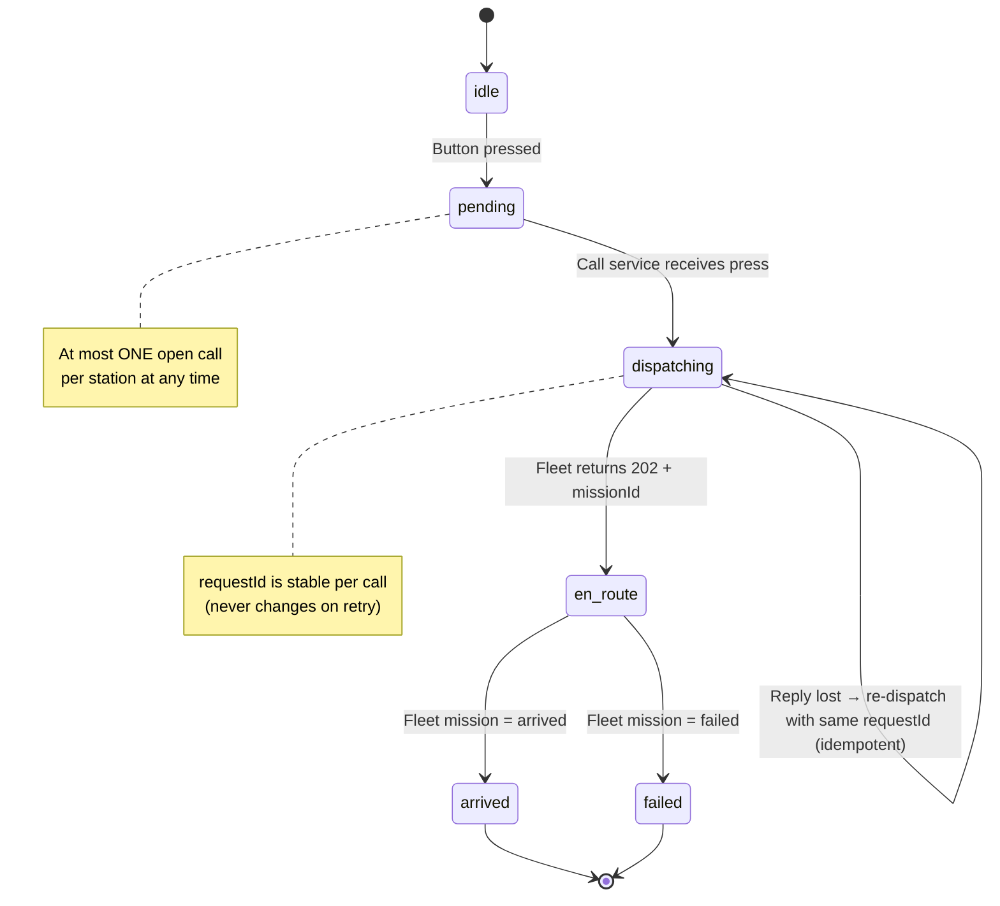
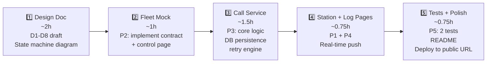

# 📋 Call Station Assignment — Work Summary

**Virya Autonomous Technologies · Systems Solutions Engineer**
_Take-Home Assignment v1.2 · November 2026 · 48h window · ~6h effort_

---

## 🎯 The Problem in One Line

> Build a system where warehouse operators can press a button at a workstation to summon a robot — with a web-based prototype and a written design document.

---

## 📦 What Must Be Delivered

| #   | Deliverable                                          | Format                    |
| --- | ---------------------------------------------------- | ------------------------- |
| 1   | **Design Document** (D1–D8)                          | PDF or Markdown, ≤4 pages |
| 2   | **Repository** with README (run + test instructions) | Git repo or ZIP           |
| 3   | **Live public URLs** for 3 pages                     | Hosted (free tier OK)     |
| 4   | **Disclosure** of AI/library usage                   | In README                 |

---

## 🏗️ High-Level Architecture



---

## 🗂️ Assignment Breakdown

### PART 1 — Design Document (Primary, Weighted Most Heavily)

| ID     | Topic                     | What to Cover                                                                                                     |
| ------ | ------------------------- | ----------------------------------------------------------------------------------------------------------------- |
| **D1** | **Architecture**          | Component diagram; what station / call service / fleet each know                                                  |
| **D2** | **Call Lifecycle**        | State machine: `idle → pending → dispatched → en_route → arrived / failed`; retry + timeout rules                 |
| **D3** | **Failure Decisions**     | 6 failure scenarios: duplicate press, lost connection, lost reply, fleet unavailable, fleet busy, service restart |
| **D4** | **Interfaces & Identity** | Transport choice + justification; example messages; how stations are ID'd and authenticated                       |
| **D5** | **Data Model**            | Schema, storage location, how "at-most-one open call per station" is enforced                                     |
| **D6** | **Scale & Operations**    | 40 stations + 10 robots: what changes, what breaks first, what to monitor                                         |
| **D7** | **Real Hardware**         | Microcontroller button: input debounce, offline behavior, power loss, credentials, OTA updates                    |
| **D8** | **Trade-offs**            | 2 key decisions with justification + conditions that would reverse each choice                                    |

---

### PART 2 — Prototype (Thin Slice)

| ID     | Requirement                             | Key Constraint                                                                                                                      |
| ------ | --------------------------------------- | ----------------------------------------------------------------------------------------------------------------------------------- |
| **P1** | **Station Page** `/station/{stationId}` | Button + status indicator + "Simulate network loss" switch. **Zero client-side state** — reload shows true server state             |
| **P2** | **Fleet Mock** + control web page       | Implements the fleet contract; control page has 4 failure-mode toggles for reviewers                                                |
| **P3** | **Call Service**                        | At-most-one open call per station; stable `requestId`; handles all 4 fleet failure modes; persisted across restarts; real-time push |
| **P4** | **Call Log Page**                       | Read-only; timestamp per state change; stations/destinations from config file                                                       |
| **P5** | **Two Automated Tests**                 | (1) double press → only one call created; (2) reply lost after dispatch → call eventually resolved                                  |

---

## 🔄 Call Lifecycle State Machine



---

## ⚠️ Failure Scenarios Addressed

| Failure                               | Behavior                                                                                                                    |
| ------------------------------------- | --------------------------------------------------------------------------------------------------------------------------- |
| **Duplicate press**                   | Second press rejected — station already has open call                                                                       |
| **Station connection lost mid-press** | On reconnect, page fetches true state from server; no duplicate call created                                                |
| **Reply lost after dispatch**         | Robot was dispatched but response lost → re-dispatch with **same** `requestId`; fleet returns original mission (idempotent) |
| **Fleet unavailable**                 | Exponential backoff + retry; call stays in `dispatching` state; persisted across service restart                            |
| **Fleet always busy**                 | Retry after `retryAfterSeconds` from 409 response; UI shows "waiting for robot"                                             |
| **Call service restarts mid-call**    | All in-flight calls are in DB; service resumes retrying on boot                                                             |

---

## 🌐 Fleet Interface Contract (Given — Do Not Modify)

```
POST /v1/dispatch          → 202 (missionId, robotId) | 409 busy | 422 unknown dest
GET  /v1/missions/{id}     → queued | en_route | arrived | failed
GET  /v1/health            → 200
```

- **Destinations:** A1–A10 and B1–B10
- **Idempotency:** Same `requestId` always returns the original mission
- **Mission duration:** ~1 minute to reach `arrived`

---

## 🧱 Key Design Decisions to Document

| Decision                          | Option A                                    | Option B                                  |
| --------------------------------- | ------------------------------------------- | ----------------------------------------- |
| **Transport (Station ↔ Service)** | WebSocket (bi-directional, low latency)     | SSE + REST (simpler, unidirectional push) |
| **State storage**                 | SQLite (simple, file-based, single process) | PostgreSQL (robust, cloud-ready)          |
| **Station auth**                  | Pre-shared token in URL/header              | mTLS (production-grade)                   |
| **Retry strategy**                | Exponential backoff with jitter             | Fixed interval                            |

---

## 📏 Scope Boundaries

| ✅ In Scope              | ❌ Out of Scope               |
| ------------------------ | ----------------------------- |
| Design doc D1–D8         | Real hardware / firmware      |
| Web prototype (P1–P5)    | Admin UI for editing stations |
| Fleet mock with controls | User accounts                 |
| Automated tests (2)      | CI/CD pipelines               |
| Public live URL          | Mobile apps                   |
|                          | Visual polish                 |

---

## 🗓️ Suggested Work Order (~6 hours)



---

> [!IMPORTANT]
> The **design document is weighted most heavily** by reviewers. Build the prototype to demonstrate design decisions — not as a finished product.

> [!NOTE]
> A 45-minute follow-up discussion will require you to defend your design and adapt it to a changed requirement. Be ready to discuss every part.
